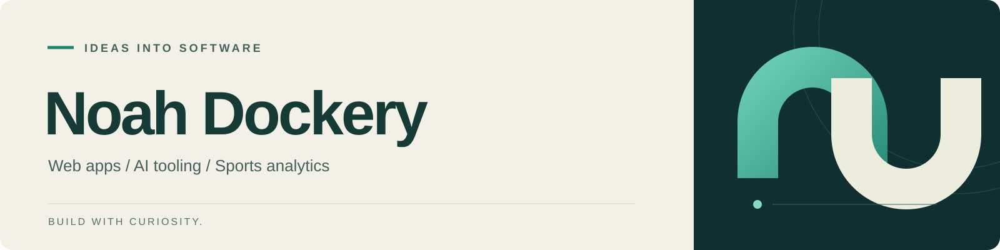

  

<strong>Web apps · AI tooling · Sports analytics</strong>

Building tools for better predictions, more useful AI workflows, 
and turning goals into daily action.

Learning by shipping.

  

  

---

### [Ultimate Frisbee Predictor](https://github.com/blackrock633/youth-ultimate-algorithmic-rankings-and-score-predictor)
Matchup analysis for youth, college, and professional ultimate. Combines Elo ratings, weather-adjusted score models, and Monte Carlo simulations, with Gemini-generated commentary.

`Python` · `Elo` · `Monte Carlo` · `Gemini`

### [Browser Harness Setup](https://github.com/blackrock633/browser-harness-setup)
Setup scripts that connect AI coding agents to local Chrome. Supports Codex, Claude Code, Antigravity, and other agents that can run shell commands.

`Shell` · `Browser Automation` · `AI Tooling`

### [Harada Goal App](https://github.com/blackrock633/harada-goal-app)
A goal-setting app built around the Harada Method’s 9×9 matrix, with daily actions and reflections to connect long-term goals to everyday progress.

`TypeScript` · `Next.js` · `Supabase`

### [BTHS Predictions](https://github.com/blackrock633/BTHS_predictions)
A prediction market project built with Next.js and Supabase.

`TypeScript` · `Next.js` · `Supabase`
